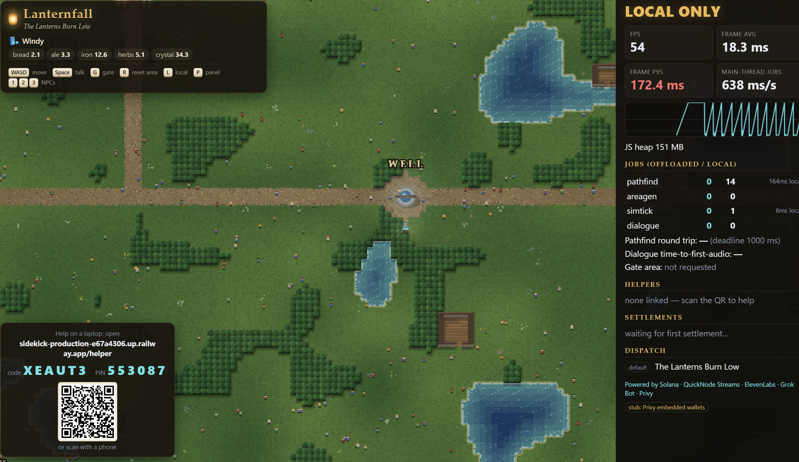

# Sidekick

Sidekick lets your friends' laptops and phones carry the heavy, delay-tolerant work of a game you are playing, and pays them devnet USDC per unit of work. Our demo game, Lanternfall, is a browser village with talking NPCs, a crowd of thousands of villagers and a gate to a procedurally generated area. Unlinked, the gaming laptop does everything and stutters. Scan a QR code with a MacBook, log in with email, and the crowd pathfinding, area generation, simulation and NPC dialogue move to that helper. The game gets smoother, the helper earns USDC settled by our Solana program, and a QuickNode Stream turns every settlement into the numbers you see on screen. Helpers never see a seed phrase, a gas fee or a wallet popup.

 <!-- TODO: add screenshot or GIF -->

**Demo video:** TODO

**Hackathon:** University Blockchain Conference 2026, Consumer Applications track. Best use of Solana, QuickNode Streams, ElevenLabs, Grok Bot.

## How it works

```
[Host Chrome /play] --socket.io--> [Server (Railway, public HTTPS)] <--socket.io-- [Runner on M3]
        |                                  |     |   |                    <--socket.io-- [Runner on M2]
   ElevenLabs via server proxy             |     |   +--> Solana devnet (sidekick_pay) --> QuickNode Stream
                                           |     |                                              |
   [Phone /helper Web Worker] --socket.io--+     +<---------- POST /webhooks/quicknode ---------+
                                           |
   Grok Bot (on X) reads /status, /status.json; writes /admin/dispatch, /api/pause-requests
```

1. The game's router (`apps/web/src/sidekick/router.ts`) sends each job to a linked helper, or runs it locally on the main thread when no helper is linked.
2. The helper computes it and signs a receipt (ed25519). The game countersigns it.
3. Every 5 s the server batches ready receipts per helper into one `settle` transaction on our Anchor program, which pays USDC from the session vault.
4. A QuickNode Stream watches the program and posts each settlement to our webhook. Earnings, the leaderboard and `/status` read only those rows.

### The four job types

The three CPU jobs live in `packages/jobs` and are pure and deterministic, so the same code runs on the host main thread, in runner `worker_threads` and in a phone Web Worker, with identical output hashes (unit tested).

| Job | Work units | What it does | Code |
| --- | --- | --- | --- |
| `dialogue` | 10 | NPC reply from Ollama (`llama3.1:8b`) on a helper laptop, streamed token by token | `apps/runner/src` |
| `areagen` | 20 | The area beyond the gate: 4-octave noise, cellular automata, building placement, A* paths, loot | `packages/jobs/src/areagen.ts` |
| `pathfind` | 2 | Crowd flow fields: Dijkstra per point of interest over the whole village, weighted by crowd density | `packages/jobs/src/flowfield.ts` |
| `simtick` | 1 | Off-screen simulation: prices, NPC schedules, weather | `packages/jobs/src/simtick.ts` |

More detail: [docs/architecture.md](docs/architecture.md), [docs/contracts.md](docs/contracts.md).

## Solana

| | |
| --- | --- |
| Program | `sidekick_pay` (Anchor), [anchor/programs/sidekick_pay](anchor/programs/sidekick_pay) |
| Program ID (devnet) | `PROGRAM_ID_PLACEHOLDER` |
| USDC mint (Circle devnet) | `4zMMC9srt5Ri5X14GAgXhaHii3GnPAEERYPJgZJDncDU` |
| Sample `settle` tx | TODO (link after the first devnet settlement) |

**Accounts**

- `Config` PDA `["config"]`: admin, settler, USDC mint, unit price (1,000 base units = 0.001 USDC per work unit), job weights.
- `Session` PDA `["session", treasury, session_id]`: budget, spent, units paid, open flag. Its vault is the session PDA's USDC token account.
- `HelperStats` PDA `["helper", helper_wallet]`: lifetime units, earnings, settlement count.

**Instructions**

| Instruction | Signer | Effect |
| --- | --- | --- |
| `initialize_config` | admin | Sets settler, mint, unit price, job weights |
| `open_session` | treasury | Creates a session and moves the USDC budget into its vault. Emits `SessionOpened` |
| `register_helper` | settler | Creates `HelperStats` for a helper wallet |
| `settle` | settler | Pays `units x unit_price` from the vault to the helper's USDC account and records the receipts Merkle root. Emits `JobsSettled` |
| `close_session` | settler | Refunds the remaining vault balance to the treasury. Emits `SessionClosed` |

**Why Solana:** helpers earn fractions of a cent per job, many times a minute. That only works with fees and confirmation times small enough to settle in batches every few seconds. Solana gives us that, USDC as a real unit of account, and PDAs that hold each session's budget with no custodian. The server pays every fee, so a helper only needs an address.

Tests: `cd anchor && anchor test` (localnet, mock mint): open, settle twice, close; settle over budget fails; non-settler settle fails.

## QuickNode Streams

| | |
| --- | --- |
| Network | Solana Devnet |
| Dataset | Block |
| Filter | [streams-filter/filter.js](streams-filter/filter.js): keeps successful transactions whose logs mention our program ID and forwards `{signature, slot, blockTime, logs}` |
| Destination | Webhook `POST <PUBLIC_BASE_URL>/webhooks/quicknode` with header `x-qn-token` |
| Handler | `apps/server/src` webhook route: decodes `Program data:` log lines into Anchor events with the IDL (`BorshCoder` + `EventParser`) and inserts `JobsSettled` rows into `settlements` |

**Why Streams:** the settlement loop never writes earnings. Every number a helper sees (USDC earned, rank, the ticker on the game screen, `/status`) comes from what the chain confirmed, delivered by the Stream. If a transaction fails or is dropped, nobody is shown money they did not get. Streams pushes each settlement within seconds, with no polling loop and no indexer to run.

## ElevenLabs

| Product | Use | Code |
| --- | --- | --- |
| Speech to Text | The player holds Space and talks to an NPC; the recording goes to `POST /api/stt` | `apps/server/src` (`/api/stt`) |
| Text to Speech (streaming) | Each sentence of the NPC's reply is voiced as it streams in, one voice per NPC, cached on disk | `apps/server/src` (`/api/tts`) |
| Sound Effects | Coin chime on each settlement, tavern ambience | `scripts/gen-sfx.ts` writes `apps/web/public/sfx/` |

When no key is configured the load panel says `Voice: browser fallback` and the game uses the browser's speech APIs.

## Grok Bot

Grok Bot is the world's writer and its network operator. Each morning it reads our public status page and recent #Lanternfall posts on X, writes the day's dispatch (world event, quests, NPC lines, the theme and seed of the area beyond the gate, and shout-outs to top helpers) and submits it through a plain HTML form at `/admin/dispatch`, so what the NPCs talk about comes from Grok Bot. Every 30 minutes it checks `/status` for alerts and files pause requests for failing helpers, and after a session closes it posts a recap on X. Prompts and chat exports are in [docs/grok-bot/](docs/grok-bot/).

## Privy

Helpers log in on `/helper` with email through Privy, which creates a Solana embedded wallet for them on login. They never see a seed phrase, a SOL balance or a signing prompt: the server's settler key pays every fee and creates their USDC account, and the program pays them directly. Without a Privy app ID the server runs a clearly labeled demo custodial mode that creates a devnet keypair per email.

## Run it

```bash
npm i -g pnpm@9
pnpm install
cp .env.example .env        # optional: everything runs with an empty .env, stubbed honestly
pnpm check:config           # shows which integrations are live and which are stubbed
pnpm build
pnpm start                  # http://localhost:8787/play and /helper
```

Development: `pnpm dev` (server on 8787, Vite on 5173 with a proxy).

Checks that need no keys:

```bash
pnpm test                   # packages/jobs determinism tests
pnpm -F @sidekick/jobs bench
pnpm smoke                  # in-process server, fake helper and fake game, one job of each type
cd anchor && anchor test    # program tests on localnet with a mock mint
```

Run a helper laptop: open the QR link from the game, log in, then run the command the page shows:

```bash
pnpm runner --server https://<host> --token <helperToken> --jobs dialogue,areagen          # M3, with Ollama
pnpm runner --server https://<host> --token <helperToken> --jobs pathfind,simtick,areagen  # M2
```

Deploy: one Railway service, `pnpm build` then `pnpm start`, with a volume for SQLite. Full steps, including the program deploy and Stream setup: [docs/demo-runbook.md](docs/demo-runbook.md).

Calibration URL parameters: `/play?villagers=2500&grid=384x288&targets=8&recomputeMs=250&areaSize=512x384&model=llama3.1:8b`.

## Honest notes

- Devnet only. USDC is Circle's devnet USDC.
- The performance difference comes from the size of the world, set by URL parameters and measured live in the load panel (frame time p95, main-thread job ms). There are no sleeps, busy loops or throttling anywhere in the local path. Unlinked, the host runs the same `packages/jobs` functions synchronously on its main thread, the way a naive game would.
- Every integration that is not configured is listed as a stub on `/status`, `/status.json` and in the load panel.
- [STATUS.md](STATUS.md) lists what is done, stubbed or skipped.
